# 📬 Gmail Organizer com n8n


Automação no **n8n** para diagnosticar, organizar e gerar relatórios de uma caixa **Gmail pessoal** com milhares de e-mails acumulados. O princípio central é **segurança por design**: nada é excluído automaticamente, e cada fase usa a menor permissão possível.

> 🇺🇸 **English summary:** an n8n automation that audits, classifies and reports on a cluttered personal Gmail inbox. It is built around least-privilege OAuth scopes (phase 1 is read-only by design), deterministic rules first with AI only for ambiguous cases, a quarantine label instead of deletion, a full audit log in Google Sheets, and automated security tests in CI.

---

## O problema

Uma caixa com mais de 10.000 e-mails: newsletters, promoções, notificações e mensagens importantes misturadas. Limpar na mão é lento. Uma automação ingênua de "apagar lixo" é arriscada, porque um boleto, um exame ou um código de recuperação classificado errado pode ser perdido.

## A abordagem

| Princípio | Como foi aplicado |
|---|---|
| **Menor privilégio** | A Fase 1 usa só o escopo `gmail.readonly`. Ela é *tecnicamente incapaz* de alterar a caixa, porque o próprio Google recusaria. |
| **Nada é excluído automaticamente** | "Lixo" vai para a label `99-REVISAR-EXCLUSAO`. Esvaziar essa label exige uma execução manual, com prévia e confirmação. |
| **Categorias protegidas** | Financeiro, saúde, documentos, segurança e trabalho nunca vão para a quarentena. |
| **Regras antes de IA** | Regras determinísticas resolvem a maioria dos casos. A IA só entra nos ambíguos, o que reduz custo e risco. |
| **Confiança baixa vai para revisão** | Se a classificação for incerta, o e-mail vai para `03-REVISAR`, nunca para a quarentena. |
| **Auditoria completa** | Cada ação registra o que havia antes, o que foi feito e o motivo. |
| **Liberação gradual** | A quarentena começa só com ruído óbvio. Newsletters e e-mails antigos entram depois de semanas de revisão. |
| **Privacidade** | As fases de organização leem só metadados e o trecho inicial. O gmail-sync lê o corpo inteiro, mas nunca envia alertas de segurança à IA e mascara números sensíveis antes. |

## Arquitetura da Fase 1 — Diagnóstico

```mermaid
flowchart LR
    A[▶ Início manual] --> B[Config]
    B --> C[Listar labels]
    C --> D[Listar IDs com anexo<br/><i>paginado</i>]
    D --> E[Juntar IDs]
    E --> F[Listar mensagens<br/><i>paginado, inclui arquivados</i>]
    F --> G[Separar] --> H[Limitar lote]
    H --> I[Buscar metadados<br/><i>10 a cada 1 s, retry</i>]
    I --> R{Falhas<br/>de cota?}
    R -- sim --> W[Esperar 65 s] --> X[Reler falhas<br/><i>mais devagar</i>] --> J
    R -- não --> J[Normalizar<br/><i>mascara códigos</i>]
    J --> K[(Sheets: dados)]
    J --> L[Agregar relatório]
    L --> M[(Sheets: nova aba<br/>relatorio_data-hora)]
    L --> N[Montar HTML] --> P[Obter meu e-mail] --> Q[Codificar MIME] --> O[✉ Enviar<br/><i>só gmail.send</i>]

    classDef read fill:#E6F4F2,stroke:#0F766E;
    class C,D,F,I,X read;
```



Os nós em verde chamam a Gmail API **apenas com GET** usando uma credencial `gmail.readonly`. O envio do relatório usa uma **segunda credencial, só com `gmail.send`**, e o destinatário é sempre o próprio dono da conta, obtido via `/users/me/profile`. A credencial nativa "Gmail" do n8n pede o escopo total `https://mail.google.com/`, por isso foi evitada de propósito.

Leituras recusadas pela cota da Gmail API (403 `rateLimitExceeded`) não se perdem: depois de 65 s, que liberam a janela de cota por minuto, elas são relidas num ritmo menor.

**O relatório gerado inclui:** cobertura da leitura (encontrados, recuperados na releitura, falhas), total de e-mails, top 30 remetentes, top domínios, e-mails por ano, por label e por categoria do Gmail, principais newsletters (com contagem de não lidos), notificações automáticas, e-mails antigos por remetente e os 30 maiores e-mails com anexo.

## Resultado na caixa real

Caixa pessoal com cerca de 10.200 e-mails, incluindo arquivados.

| | Antes | Depois |
|---|---|---|
| Leitura do diagnóstico | 5.907 de 10.218 (57,8%); 4.311 leituras recusadas por cota | 10.232 de 10.232 (100%); 4.684 recuperadas na releitura, 0 falhas |
| E-mails sem marcador | caixa sem organização | 14 |
| Organização | — | ~10.050 e-mails marcados pela Fase 2/3, ~10% enviados para revisão manual, 0 erros |

Nenhum e-mail foi excluído: a Fase 2/3 só adiciona marcadores.

Detalhes técnicos em [`docs/arquitetura.md`](docs/arquitetura.md) e no modelo de segurança em [`docs/seguranca.md`](docs/seguranca.md).

## Roadmap

| Fase | Entrega | Escopo Gmail | Status |
|---|---|---|---|
| 1. Diagnóstico | Leitura completa, planilha e relatório por e-mail | `gmail.readonly` + `gmail.send` | ✅ Concluída |
| 2. Classificação | Regras determinísticas (protegidas primeiro), auditoria em planilha, DRY RUN por padrão | `gmail.readonly` | ✅ Concluída |
| 3. Organização | Aplicação de marcadores via `batchModify` (só adiciona); arquivamento e quarentena em etapas | `gmail.modify` | 🟡 Marcadores aplicados; arquivamento e quarentena pendentes |
| 4. Relatórios | Resumo diário, semanal e mensal dos e-mails novos ([detalhes](docs/gmail-sync.md)) | `gmail.readonly` + `gmail.send` | 🧪 Em validação |
| 5. Manutenção | Rotina diária e workflow manual "Esvaziar quarentena" | `gmail.modify` | ⏳ Planejada |
| gmail-sync | E-mails novos resumidos pelo Gemini, marcados e, quando têm data, levados ao Google Agenda ([detalhes](docs/gmail-sync.md)) | `gmail.readonly` + `gmail.modify` + `calendar.events.owned` | 🧪 Em validação |

O escopo `https://mail.google.com/`, único que permite exclusão permanente, **não é usado em nenhuma fase**.

## E-mails novos: resumo, marcador, agenda e relatórios

Para o que chega daqui em diante (a partir de `inicioEm`), dois workflows trabalham juntos:

- **gmail-sync** (a cada 15 min): aplica o marcador certo, pede ao **Gemini** um resumo curto e, se o e-mail traz um compromisso com data, cria o evento numa agenda dedicada do Google Agenda.
- **gmail-relatorios**: manda para o seu e-mail um resumo **diário** (22h), **semanal** (domingo, 22h) e **mensal** (dia 1, 8h), com os resumos, os compromissos, a contagem por marcador, as promoções por remetente e o que ficou para revisar.

- **Regras antes da IA.** As regras da Fase 2/3 decidem o marcador quando casam; o Gemini só escolhe no resto, de uma lista fechada e sem a quarentena, e com pouca certeza o e-mail vai para `03-REVISAR`.
- **Privacidade antes da IA.** Promoções, newsletters e alertas de segurança não vão para o Gemini, e cartão, CPF, linha digitável e códigos são mascarados.
- **Gmail só ganha marcadores**; no Calendar o workflow só lista e insere eventos, sem convidados. Eventos que você apagou não voltam.
- `DRY_RUN` por padrão, gatilhos agendados desativados até a validação, e cada e-mail registrado na aba `emails_novos`.

Configuração, credenciais e teste manual em [`docs/gmail-sync.md`](docs/gmail-sync.md).

## Como usar

1. Crie um projeto no Google Cloud e ative as APIs do Gmail, Sheets e Drive.
2. Crie uma credencial **Google OAuth2 API** no n8n com o escopo `https://www.googleapis.com/auth/gmail.readonly`.
3. Crie a planilha `Gmail - Diagnóstico` com as abas `dados` e `relatorio`.
4. Importe [`workflows/fase1-diagnostico.json`](workflows/fase1-diagnostico.json) e ligue as credenciais.
5. Rode primeiro com `maxEmails = 200` e depois na caixa inteira.

📘 O passo a passo completo, do zero e com solução de problemas, está no **[Playbook de implementação (PDF)](docs/playbook-fase1.pdf)**. O playbook cobre a configuração inicial; as melhorias posteriores (envio por e-mail, aba por execução, ajuste de cota) estão no [CHANGELOG](CHANGELOG.md).

## Qualidade e testes

```bash
npm test          # testes de segurança e de lógica (Node 20+, sem dependências)
npm run extract   # extrai o JS dos nós Code para src/code-nodes/
```

O CI (GitHub Actions) valida a cada push que:
- a leitura usa **apenas GET**, e o único POST é o envio do relatório para o próprio e-mail;
- o nó Gmail nativo, que tem escopo amplo, não é usado;
- não há gatilho automático nem segredos (client secret, tokens) no JSON;
- a lógica de normalização, mascaramento e agregação funciona com mensagens simuladas;
- o código em `src/` está sincronizado com o workflow.

## Estrutura

```
├── workflows/
│   ├── fase1-diagnostico.json         # diagnóstico somente leitura
│   ├── fase2-3-classificar-aplicar.json # classificação + aplicação de marcadores
│   ├── gmail-sync.json                # e-mails novos: resumo, marcador e agenda (Gemini)
│   └── gmail-relatorios.json          # resumo diário, semanal e mensal por e-mail
├── src/code-nodes/                    # JS dos nós Code, legível para revisão
├── tests/                             # testes de segurança e lógica (58)
├── scripts/extract-code-nodes.js      # sincroniza src/ a partir do JSON
├── docs/
│   ├── playbook-fase1.pdf             # guia de implementação do zero
│   ├── arquitetura.md                 # nó a nó, API, paginação, limites
│   ├── seguranca.md                   # modelo de ameaças e escopos
│   ├── planilhas.md                   # esquema das planilhas
│   ├── gmail-sync.md                  # e-mails novos e relatórios: configuração e teste
│   └── regras.md                      # regras de classificação
└── .github/workflows/ci.yml
```

## Stack

<p>
  
  
  
  
  
  
  
  
  
</p>

| Tecnologia | Papel no projeto |
|---|---|
| **n8n** (self-hosted) | Orquestração dos workflows |
| **Gmail API (REST)** | Leitura, envio do relatório e aplicação de marcadores, cada um com escopo próprio |
| **Google OAuth 2.0** | Credenciais separadas por escopo (`readonly`, `send`, `modify`, `calendar.events.owned`) |
| **Google Sheets API** | Relatórios de diagnóstico e trilha de auditoria |
| **Google Calendar API** | Criação dos eventos do gmail-sync, só com escopo de eventos |
| **Gemini API** | Resumo, marcador sugerido e compromissos dos e-mails novos, com saída em JSON de esquema fixo |
| **JavaScript** | Lógica dos nós Code: normalização, classificação e agregação |
| **Node.js `node --test`** | Testes de segurança e lógica, sem dependências |
| **GitHub Actions** | CI: valida o JSON, roda os testes e confere a sincronia de `src/` |

## Autor

**Eric Andrey dos Santos** — Análise e Desenvolvimento de Sistemas · Segurança Cibernética · Pato Branco, PR — [LinkedIn](https://linkedin.com/in/Eranzito) · [GitHub](https://github.com/Eranzitoo)
